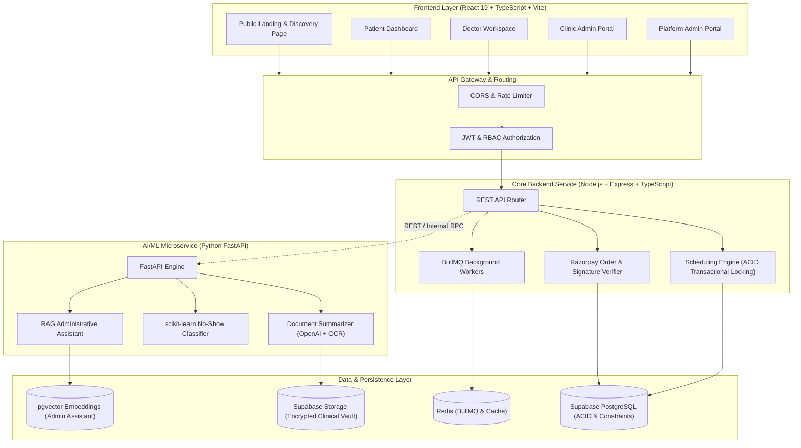

# 🏗️ MediSlot System Architecture & Design Specification

> **MediSlot — AI-Powered Smart Clinic Booking & Management System**

---

## 1. High-Level Architecture Diagram

---

## 2. Multi-Tier Security & Tenant Isolation

1. **Role-Based Access Control (RBAC)**:
   - `PATIENT`: Can only read/write own profile, appointments, and uploaded health documents.
   - `DOCTOR`: Scoped strictly to assigned patients and clinical appointment queues.
   - `CLINIC_ADMIN`: Scoped to clinic-level membership, doctors, staff, and clinic revenues.
   - `PLATFORM_ADMIN`: Global platform health, compliance logs, and clinic onboarding.
2. **ACID Transaction Isolation**:
   - Double-booking prevention implemented via PostgreSQL row-level locks (`SELECT FOR UPDATE`) and unique composite constraints `(doctor_id, scheduled_start)`.
3. **Protected Health Information (PHI)**:
   - Private Supabase Storage buckets with pre-signed short-lived URLs.
   - Medical documents are never publicly exposed or indexed by search engines.
