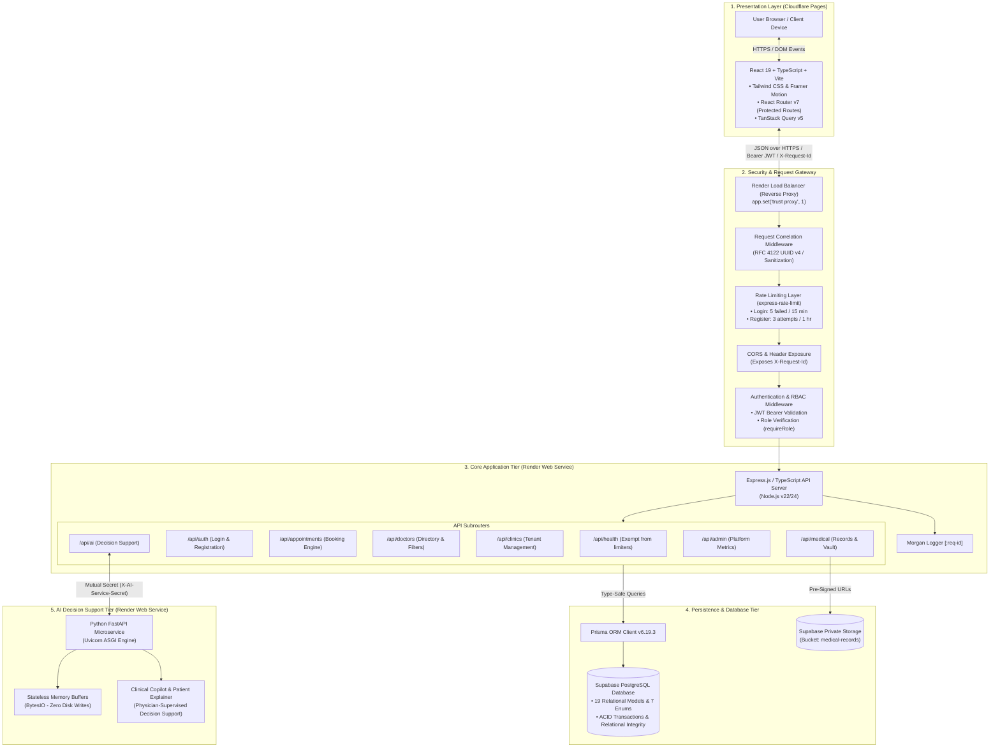
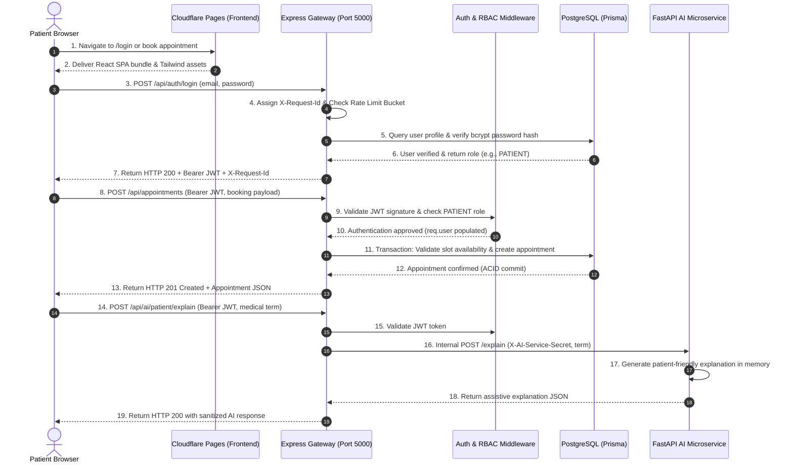

# 🏗️ MediSlot System Architecture & Design Specification

> **MediSlot — AI-Powered Smart Clinic Booking & Healthcare Management Platform**

This document provides a comprehensive technical breakdown of the MediSlot system architecture, service communication protocols, security layers, and data flow.

---

## 1. High-Level System Architecture Diagram

---

## 2. Service Separation & Responsibilities

MediSlot adopts a modular, microservice-supported architecture designed for security, scalability, and clinical safety:

### A. Presentation Tier (React 19 + TypeScript)
* **Hosted on:** Cloudflare Pages (Edge CDN).
* **Role:** Single Page Application (SPA) delivering client-side routing, state management, and responsive UI components across desktop, tablet, and mobile viewports.
* **Security:** Employs client-side route guards (`ProtectedRoute.tsx`) that inspect the authenticated user's role before rendering views. Frontend state never replaces backend validation.

### B. Core Application Tier (Express.js + TypeScript)
* **Hosted on:** Render Web Service (Node.js).
* **Role:** Central API gateway and business logic coordinator. Enforces business validation using Zod schemas, manages user sessions, and orchestrates database transactions.
* **Security:**
  * **Reverse Proxy Trust:** Configured with `app.set("trust proxy", 1)` so that Express correctly evaluates client remote IPs from Render's `X-Forwarded-For` header.
  * **Request Tracing:** Intercepts every incoming request with `requestIdMiddleware` to ensure a consistent RFC 4122 UUID v4 correlation token (`X-Request-Id`) across console logs and client responses.
  * **Rate Limiting:** Protects `/api/auth/login` and `/api/auth/register` from brute-force dictionary attacks and bot registrations.

### C. Data & Persistence Tier (PostgreSQL + Prisma)
* **Hosted on:** Supabase PostgreSQL.
* **Role:** Relational data store enforcing data integrity, foreign key relations, and transactional concurrency control for appointment scheduling.
* **ORM:** Prisma Client v6.19.3 provides full type safety between TypeScript models and SQL tables.

### D. AI Decision Support Tier (Python FastAPI)
* **Hosted on:** Render Web Service (Python/Uvicorn).
* **Role:** Dedicated microservice for compute-intensive natural language processing, consultation draft generation, and medical report summarization.
* **Mutual Authentication:** Completely private from public web traffic. Rejects any incoming request lacking a valid `X-AI-Service-Secret` header matching the backend's internal environment configuration.
* **Stateless Processing:** Processes patient documents in transient memory buffers (`BytesIO`). Zero patient health information is persisted to disk on the AI tier.

---

## 3. Role-Based Access Control (RBAC) Matrix

MediSlot categorizes users into four mutually exclusive operational roles:

| Endpoint Subrouter | Public | `PATIENT` | `DOCTOR` | `CLINIC_ADMIN` | `PLATFORM_ADMIN` |
|---|:---:|:---:|:---:|:---:|:---:|
| `GET /api/health` | ✅ Allowed | ✅ Allowed | ✅ Allowed | ✅ Allowed | ✅ Allowed |
| `GET /api/doctors` | ✅ Allowed | ✅ Allowed | ✅ Allowed | ✅ Allowed | ✅ Allowed |
| `GET /api/clinics` | ✅ Allowed | ✅ Allowed | ✅ Allowed | ✅ Allowed | ✅ Allowed |
| `POST /api/auth/login` | ✅ Allowed | ✅ Allowed | ✅ Allowed | ✅ Allowed | ✅ Allowed |
| `POST /api/auth/register` | ✅ Allowed | ✅ Allowed | ✅ Allowed | ✅ Allowed | ✅ Allowed |
| `GET /api/auth/me` | ❌ 401 | ✅ Allowed | ✅ Allowed | ✅ Allowed | ✅ Allowed |
| `POST /api/appointments` | ❌ 401 | ✅ Book own | ❌ 403 | ❌ 403 | ✅ Allowed |
| `GET /api/appointments/my` | ❌ 401 | ✅ Own appts | ❌ 403 | ❌ 403 | ❌ 403 |
| `GET /api/appointments/doctor/:id` | ❌ 401 | ❌ 403 | ✅ Own queue | ❌ 403 | ✅ Allowed |
| `GET /api/appointments/clinic/:id` | ❌ 401 | ❌ 403 | ❌ 403 | ✅ Own clinic | ✅ Allowed |
| `GET /api/admin/stats` | ❌ 401 | ❌ 403 | ❌ 403 | ❌ 403 | ✅ Allowed |
| `POST /api/ai/copilot/*` | ❌ 401 | ❌ 403 | ✅ Allowed | ❌ 403 | ✅ Allowed |
| `POST /api/ai/patient/*` | ❌ 401 | ✅ Allowed | ✅ Allowed | ✅ Allowed | ✅ Allowed |

---

## 4. End-to-End Request & Response Flow

---

## 5. Architectural Reliability & Limitations

1. **In-Memory Rate Limiting:**
   * Rate limiting quotas are tracked using Node.js process memory (`MemoryStore`). This provides zero-dependency speed for single-instance web services. In a distributed multi-instance deployment, this would be backed by Redis.
2. **Reverse Proxy Topology:**
   * `trust proxy: 1` explicitly trusts the single hop between Render's cloud load balancer and the container. If Cloudflare CDN proxying is enabled in front of Render in the future, the hop count would be updated accordingly.
3. **Container Cold-Starts:**
   * On Render's free tier, backend containers enter sleep mode after 15 minutes of inactivity. Initial requests after sleep take ~30–45s to warm up; subsequent requests respond in under 150 ms.
